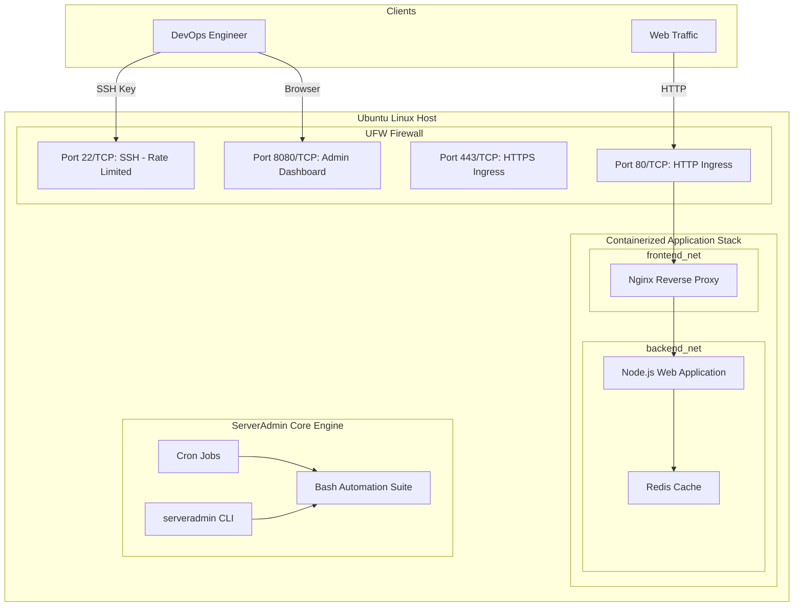

# Linux Server Administration & Deployment Automation Engine

[](https://ubuntu.com/)
[](https://www.gnu.org/software/bash/)
[](https://www.docker.com/)
[](https://nginx.org/)
[](LICENSE)

An enterprise-ready, end-to-end **Linux Server Administration Engine, Orchestration Platform, and DevOps Automation Lab** tailored for Ubuntu Linux environments.

---

## 📋 Core Capabilities & Lab Focus

This platform implements the complete Linux Server Administration & Deployment Automation lifecycle:

1. **Ubuntu VM Provisioning & Remote SSH Administration**:
   - Automated bootstrap script (`scripts/provision_vm.sh`) for fresh Ubuntu cloud instances (AWS EC2, GCP, DigitalOcean, Hetzner, Multipass, Vagrant).
   - Ed25519 SSH key generation, public key injection, and hardened OpenSSH daemon configuration.
   - Dual execution capability: manage remote nodes via SSH or run directly on localhost.

2. **Core Linux System Administration**:
   - Least-privilege user and group provisioning (`scripts/setup_users.sh`).
   - Granular sudo privileges via `/etc/sudoers.d/`.
   - File permission hardening (POSIX 0700/0600 keys, 0440 sudoers).
   - Process tree inspection (`ps`, `htop`, `systemd`) and unit lifecycle controls.

3. **Production Bash Automation Scripts**:
   - **`disk_monitor.sh`**: Filesystem & inode threshold monitoring (80% warn, 90% crit) with top consumer discovery.
   - **`service_health.sh`**: Systemd watchdog with automated self-healing restarts and exponential backoff.
   - **`log_collector.sh`**: Centralized log aggregation, brute-force & auth error parsing, and compressed archiving.
   - **`backup_engine.sh`**: Timestamped, gzip-compressed backups with SHA-256 integrity verification and automated retention pruning.
   - **Automated Cron Scheduling**: Pre-configured cron definitions installed in `/etc/cron.d/`.

4. **Containerized Deployment Stack (Docker Compose & Nginx)**:
   - Multi-tier isolated container network:
     - **`serveradmin_nginx`**: Public ingress gateway, gzip compression, rate limiting (10 req/s), security headers.
     - **`serveradmin_webapp`**: Hardened Node.js application running as non-root user `node`.
     - **`serveradmin_cache`**: Password-protected Redis 7 instance isolated in internal backend network.
   - Configuration management driven through `.env` environment variables.

5. **Host Security & Port Exposure Documentation**:
   - Uncomplicated Firewall (UFW) automation with rate-limited SSH.
   - Real-time listening sockets and exposed services auditor (`scripts/firewall_setup.sh audit`).
   - Complete documented port registry ([ARCHITECTURE.md](docs/ARCHITECTURE.md)) and incident response runbook ([SECURITY_RUNBOOK.md](docs/SECURITY_RUNBOOK.md)).

6. **Unified Management CLI & Web Control Plane**:
   - Python-based CLI (`bin/serveradmin`) with rich terminal UI.
   - Standalone, zero-dependency Web Management Console (`web_platform/`) with live telemetry and one-click script triggers.

---

## 🏛️ System Architecture



---

## 🚀 Quickstart Guide

### 1. Clone the Repository
```bash
git clone https://github.com/your-org/serverAdmin.git
cd serverAdmin
```

### 2. Run Automated Test Suite
Validate syntax, dry-run routines, backup SHA-256 verification, and CLI functions:
```bash
make test
```

### 3. Using the `serveradmin` CLI
The `serveradmin` CLI supports both local host management and remote management over SSH (`-r <host>`):

```bash
# Check host health and systemd status
./bin/serveradmin status

# Check remote Ubuntu host over SSH
./bin/serveradmin --remote 192.168.1.100 --user ubuntu --key ~/.ssh/id_ed25519 status

# User management (least-privilege creation)
./bin/serveradmin user list
sudo ./bin/serveradmin user add deploy -G docker --sudo --nopasswd

# Run disk and inode threshold checks
./bin/serveradmin disk --warn 80 --crit 90

# Trigger verified timestamped backup
./bin/serveradmin backup run
./bin/serveradmin backup verify

# Audit listening sockets and firewall posture
./bin/serveradmin security audit
```

### 4. Deploying the Containerized App Stack
```bash
# Launch Docker Compose stack (Nginx + Web App + Redis)
make compose-up

# Check running containers
make compose-logs
```

Test the reverse proxy:
```bash
curl -I http://localhost/
curl -I http://localhost/healthz
```

### 5. Launching the Web Management Console
Start the lightweight web control plane on port `8080`:
```bash
make run-web
# Open http://localhost:8080 in your browser
```

---

## 📁 Repository Structure

```
serverAdmin/
├── bin/
│   └── serveradmin                 # Unified executable CLI entrypoint
├── core/                           # Python-based control & orchestration engine
│   ├── __init__.py
│   ├── connection.py               # Local and remote SSH command runner
│   ├── security.py                 # Security auditing and firewall controls
│   ├── service_manager.py          # Systemd and process management wrapper
│   ├── system_inspector.py         # System metrics and telemetry gatherer
│   └── user_manager.py             # User, group, and sudoers administration
├── scripts/                        # Production Bash administration scripts
│   ├── backup_engine.sh            # SHA-256 verified, timestamped backup engine
│   ├── disk_monitor.sh             # Threshold-based disk & inode monitor
│   ├── firewall_setup.sh           # UFW configuration & open port scanner
│   ├── log_collector.sh            # Log aggregator, parser & compressor
│   ├── provision_vm.sh             # Automated Ubuntu VM bootstrap script
│   ├── service_health.sh           # Systemd watchdog with self-healing restarts
│   └── setup_users.sh              # Least-privilege user & SSH key provisioner
├── app_stack/                      # Containerized deployment with Docker & Nginx
│   ├── docker-compose.yml          # Multi-container orchestration
│   ├── .env.example                # Application environment variables template
│   ├── .env                        # Active environment configuration
│   ├── web_app/                    # Hardened Node.js status service
│   │   ├── Dockerfile              # Multi-stage non-root build
│   │   ├── package.json
│   │   └── src/server.js
│   └── nginx/                      # Production Nginx reverse proxy
│       ├── Dockerfile
│       ├── nginx.conf              # Gzip, rate-limiting & logging
│       └── conf.d/default.conf     # Upstream reverse proxy & security headers
├── web_platform/                   # Web-based management console (Admin Dashboard)
│   ├── server.js                   # Zero-dependency Node.js HTTP server & API
│   └── public/
│       └── index.html              # Modern dark-mode control plane UI
├── docs/                           # Documentation & Lab Guides
│   ├── LAB_MANUAL.md               # Step-by-step practical guide from scratch
│   ├── ARCHITECTURE.md             # System topology & port exposure matrix
│   └── SECURITY_RUNBOOK.md         # Threat model, auditing & disaster recovery
├── tests/
│   └── test_suite.sh               # 14-step automated validation test runner
├── Makefile                        # Convenient one-command tasks
└── README.md                       # Platform documentation
```

---

## 📖 In-Depth Documentation Links

- **[Practical Lab Manual](docs/LAB_MANUAL.md)**: Detailed step-by-step tutorial covering VMs, SSH, user administration, script scheduling, Docker deployment, and security hardening.
- **[Architecture & Port Exposure Matrix](docs/ARCHITECTURE.md)**: Comprehensive network architecture, component interactions, and port inventory table.
- **[Host Security Runbook](docs/SECURITY_RUNBOOK.md)**: Threat mitigation guidelines, security auditing checklists, and disaster recovery restore procedures.

---

## 📄 License
This project is open-source and licensed under the [MIT License](LICENSE).

